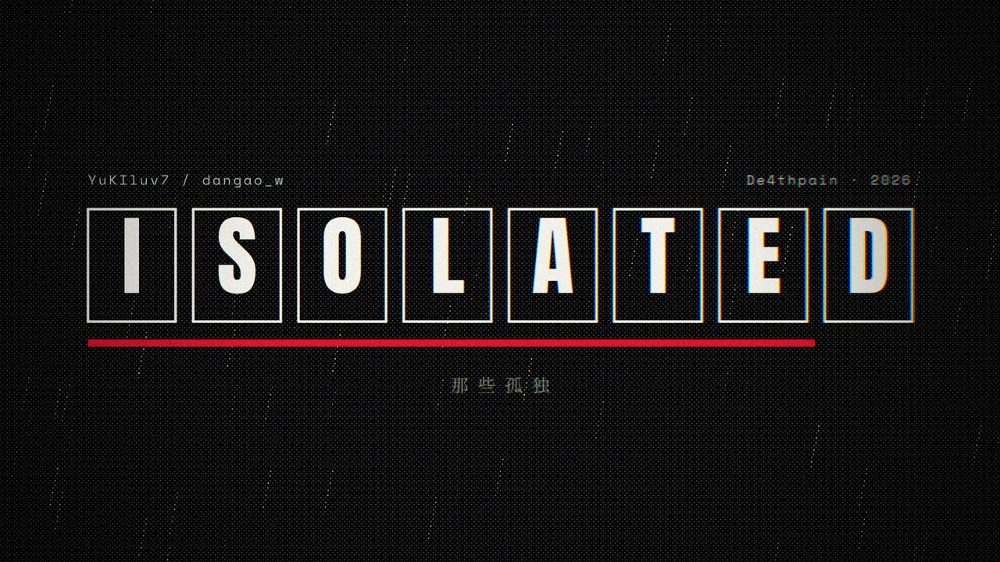

# Isolated · 歌词 MV

YuKIluv7 / dangao_w《Isolated》（专辑《De4thpain》，2026）的歌词 MV。时长 2:04，1920 × 1080，30 fps。

画面全部由 HTML Canvas + WebGL 逐帧绘制：雨夜的城市、亮灯的楼、路灯长路、稿纸、月亮、海和玫瑰都由程序画出来，再被印成黑白网点漫画，全片不使用封面画；唱到「我内心早已变黑白」时颜色被一条线扫掉，之后全片只剩黑、白和一种红；前半首下雨，唱到「back to you, yuki」以后雨变成雪。画面跟着鼓点走——鼓的起止、底鼓、军鼓的时间都来自分轨音频分析。分镜见 [脚本.md](脚本.md)。



## 观看

- 打开 `Isolated_MV.html`：单文件播放器，内嵌音乐和字体，离线可用。
- 或在本目录打开 `mv.html`（需要 `assets.js` 和 `Isolated.mp3` 在同一目录）。
- 空格暂停，F 全屏，← → 快退快进 5 秒。
- MP4 是生成文件，不纳入 Git，按下面的步骤导出。

## 文件

| 文件 | 用途 |
| --- | --- |
| `脚本.md` | 分镜脚本：每句歌词的画面、时间码和节奏点 |
| `mv.html` | 动画与播放器源码（所有分镜、网点着色器、歌词排版） |
| `assets.js` | 由 `prepare.py` 生成：节拍与鼓点、各分轨包络、歌词与翻译、字体子集 |
| `prepare.py` | 分析 `Isolated.mp3` 与 `stems/` 分轨，读取 LRC 和 MP3 内嵌的翻译歌词，裁剪字体，写出 `assets.js` |
| `export.mjs` | 用无头 Chrome 逐帧渲染，PNG 无损交给 FFmpeg 编码 |
| `build.py` | 把 `mv.html`、`assets.js`、`Isolated.mp3` 合成单文件 `Isolated_MV.html` |
| `Isolated.mp3` / `Isolated.lrc` | 成品音乐与歌词时间轴 |
| `stems/` | 鼓、贝斯、伴奏分轨（只用于分析） |

## 重新生成

需要 Python 3（`numpy`、`scipy`、`fonttools`）、Node.js 22+、FFmpeg，以及 Chrome / Edge / Chromium。在本目录运行：

```bash
python -m pip install numpy scipy fonttools
python prepare.py                 # 音频分析 + 字体子集 -> assets.js（首次会从 Google Fonts 下载字体到 .fonts/）
node export.mjs --shots 7.6,43.5  # 先看几帧，写到 shots/
node export.mjs --share           # 整片：Isolated_MV.mp4（母版）+ Isolated_MV_share.mp4（分享版）
python build.py                   # 单文件播放器 Isolated_MV.html
```

改了 `mv.html` 里的中文文字后要重新运行 `prepare.py`，字体子集才会包含新字。

### 导出原理

`export.mjs` 同时开几个无头 Chrome，每个都以 `?export=1` 打开 `mv.html`，按帧号请求 `__frame(t)`：页面在精确的时间点 `t = i / 30` 画出这一帧，用 `canvas.toDataURL('image/png')` 返回 **PNG（无损）**。帧按顺序写进 FFmpeg 的 `image2pipe`，所以结果与机器速度、进程数无关。

| 命令 | 输出 |
| --- | --- |
| `node export.mjs` | `Isolated_MV.mp4`，H.264 CRF 16，AAC 320k |
| `node export.mjs --share` | 另外从同一批 PNG 帧编码 `Isolated_MV_share.mp4`（CRF 24，体积小，适合发送） |
| `node export.mjs --lossless` | `Isolated_MV_lossless.mkv`：RGB 无损（x264 `qp 0`），与 PNG 帧逐像素一致，音频原样复制；体积非常大 |
| `node export.mjs --frames frames` | 同时把每一帧 PNG 存到 `frames/` |
| `--from 30 --to 40`、`--workers 3`、`--crf 18` | 只导出一段、指定进程数、调整码率 |

没有显卡的机器上 Chrome 会用 SwiftShader 软件渲染，四核约 3 帧/秒，整片约 22 分钟。网点和颗粒很吃码率：母版约 750 MB，分享版约 240 MB。需要发到有大小限制的地方时，可以从母版压一个 720p 预览（约 28 MB）：

```bash
ffmpeg -i Isolated_MV.mp4 -vf scale=1280:720:flags=lanczos -c:v libx264 -preset slow -b:v 1720k -pass 1 -an -f mp4 /dev/null
ffmpeg -i Isolated_MV.mp4 -vf scale=1280:720:flags=lanczos -c:v libx264 -preset slow -b:v 1720k -pass 2 -c:a aac -b:a 128k -movflags +faststart Isolated_MV_preview_720p.mp4
```

## 字体

Noto Serif SC、Zhi Mang Xing、Cormorant Garamond、Anton、Space Mono（均为 SIL Open Font License），只保留片中用到的字形，以 base64 嵌在 `assets.js` 中。
